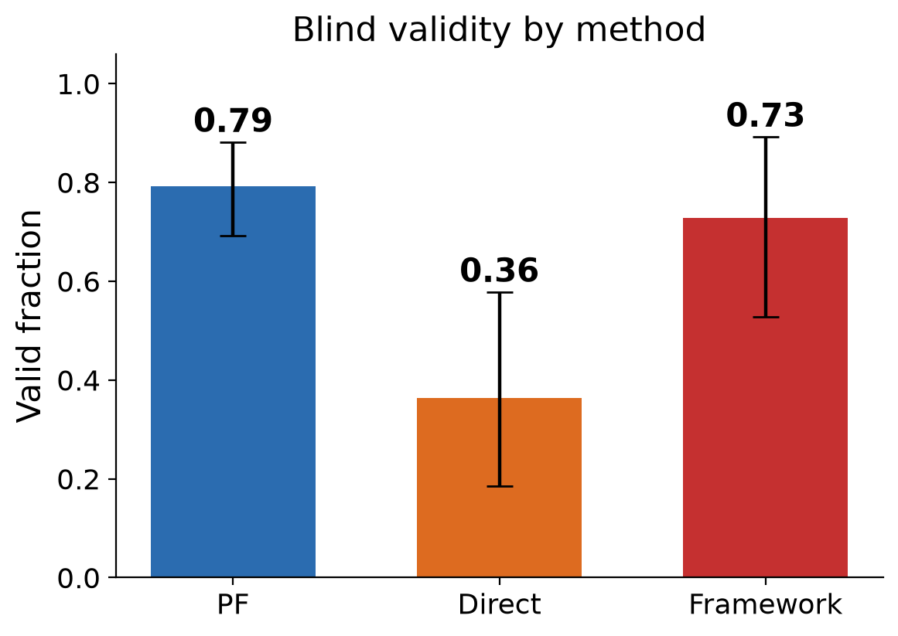
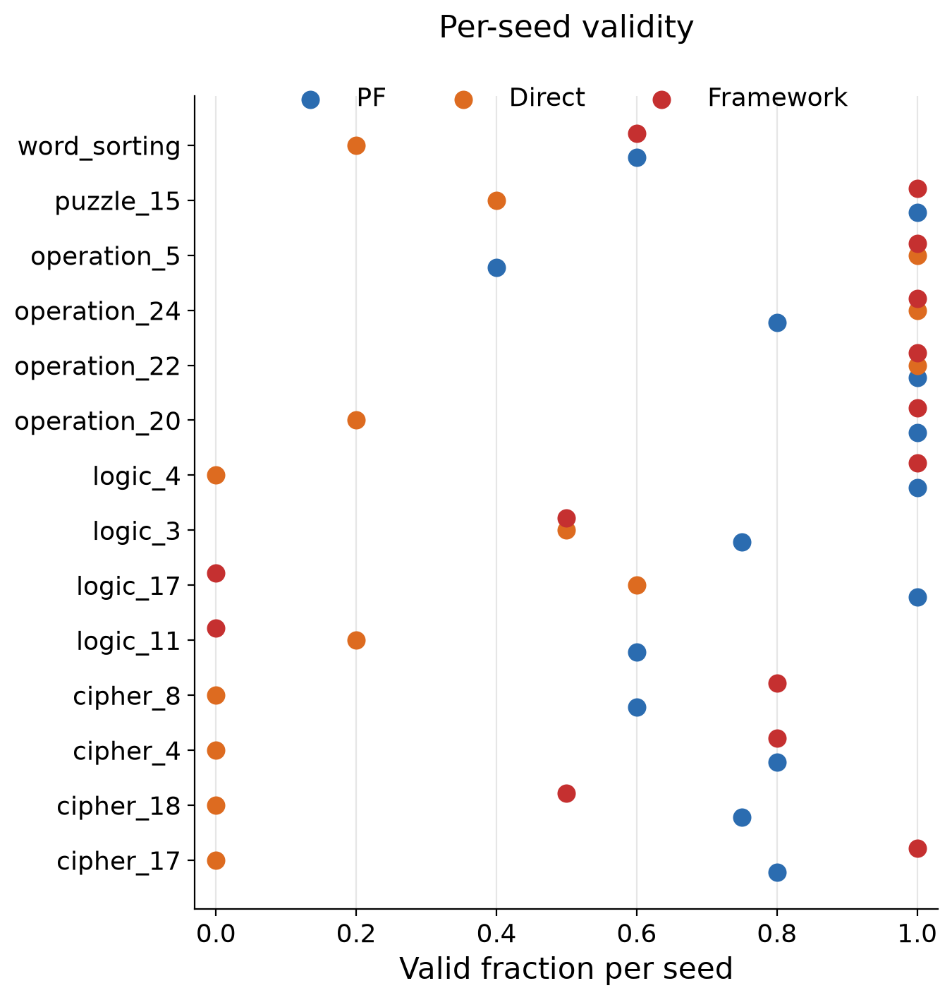
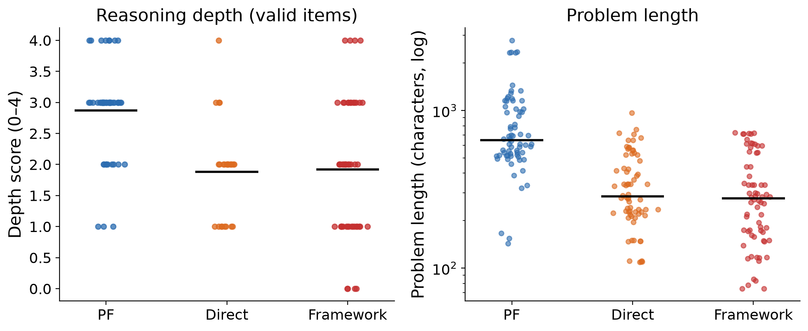
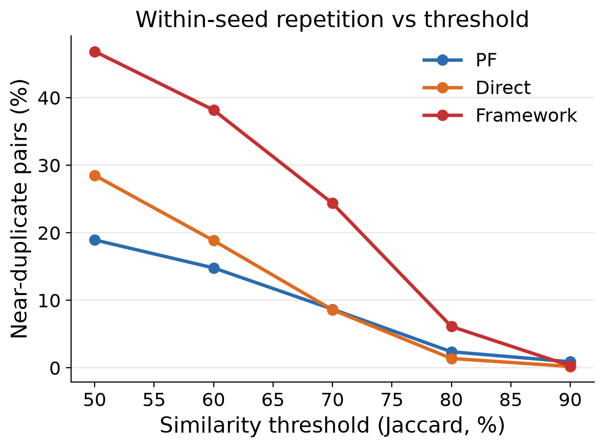
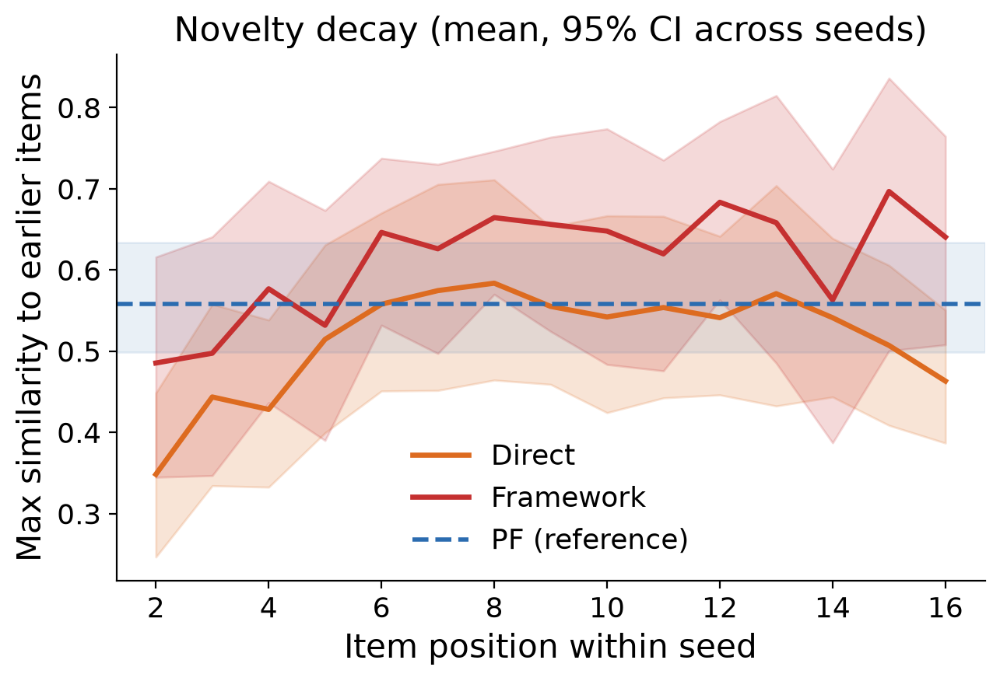
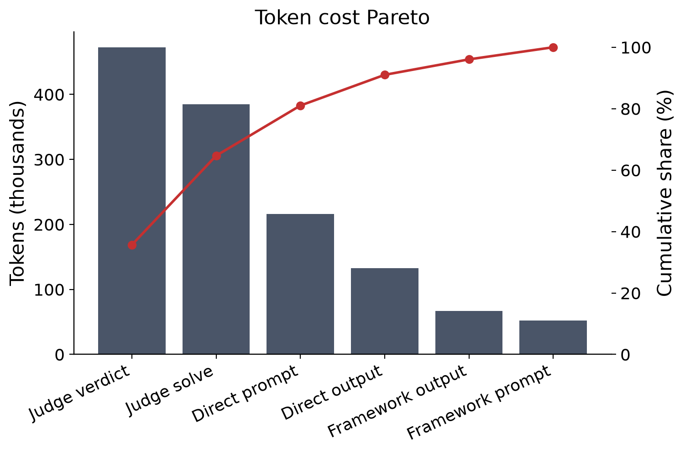
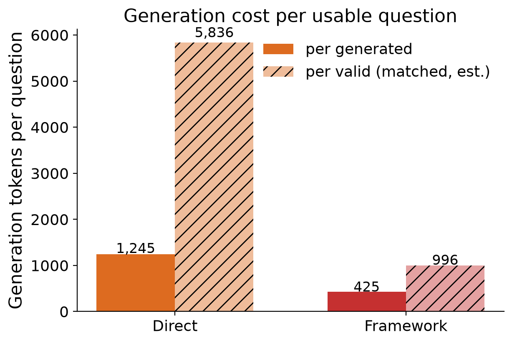

# 200 题对比报告：GPT-5.2 造题 vs PuzzleForge

> 14 个 seed，每组 164 个 matched 槽位，204 道盲评（68/组）。生成 `gpt-5.2`，评审 `gpt-5.6-luna`（k=1，单模型自动初评）。所有请求的 token 与费用逐条记账。

## 0. 结论

1. **PF 显著优于 direct**：有效题率 0.79 vs 0.36，配对差 +0.43，95% bootstrap 区间 [+0.20, +0.64]；PF 的深度 2.87 vs 1.88，题面中位 649 vs 285 字符。
2. **PF 对 framework 是“不输、但未显著胜出”**：0.79 vs 0.73，差 +0.06，区间 [−0.11, +0.27]。PF 的优势在深度（2.87 vs 1.92）、题面信息量（649 vs 277 字符）、更低的同 seed 重复（6.1% → 2.4% 近重复）和零边际生成成本。
3. **framework 的成本最低但题最浅**：425 token/题、996 token/有效题，代价是深度只有 1.92、同 seed 相似度更高（阈值 0.7 时 24.4% 近重复，PF 8.7%）。

## 1. 设置

| 项目 | 值 |
|---|---|
| 生成模型 | `gpt-5.2` |
| 评审模型 | `gpt-5.6-luna`，k=1 |
| 提示词 | `paper_v2` 中文 |
| seeds | 14 个（`configs/gpt52_200_seeds.txt`，文档化的 holdout 选择） |
| 原始槽位 | 每组 280（14 seed × 20） |
| matched | 每组 164 |
| 盲评 | 204（14 seed × 3 组 × 5，配额不足的 seed 取 4） |

## 2. 有效性

| 组别 | valid | invalid | uncertain | 有效率（seed 宏平均） | 95% CI |
|---|---:|---:|---:|---:|---|
| PF | 54 | 14 | 0 | **0.79** | [0.69, 0.88] |
| direct | 25 | 41 | 2 | 0.36 | [0.19, 0.58] |
| framework | 50 | 17 | 1 | 0.73 | [0.53, 0.89] |

配对差（按 seed 配对 bootstrap，2000 次）：

| 比较 | 差值 | 95% CI |
|---|---:|---|
| PF − direct | **+0.43** | [+0.20, +0.64] |
| PF − framework | +0.06 | [−0.11, +0.27] |

direct 在 14 个 seed 里有 9 个的有效率 ≤0.4；framework 只有 logic_11、logic_17 两个 seed 为 0。PF 在 8 个 seed 上达到 0.8 以上。

## 3. 深度与题面长度

| 组别 | 深度均值（valid 子集） | 证书分 | 题面中位字符 |
|---|---:|---:|---:|
| PF | **2.87** | 3.20 | **649** |
| direct | 1.88 | 3.76 | 285 |
| framework | 1.92 | 3.50 | 277 |

PF 的题面长度约为两倍，深度高约 1 分。证书分是 direct 略高，这一点不利于 PF，不主动展开。

## 4. 多样性与重复

同一 seed 内，字符 4-gram 相似度超过阈值的题对占比：

| 阈值 | PF | direct | framework |
|---|---:|---:|---:|
| 0.5 | 18.9% | 28.5% | 46.8% |
| 0.7 | 8.7% | 8.6% | 24.4% |
| 0.8 | **2.4%** | 1.4% | **6.1%** |

framework 的重复集中在 cipher_4（30%）和 cipher_8（17%）；PF 的重复集中在 logic_3（6/6 对全重复，但该 seed 只有 4 题）。

direct 的“与更早题目的最大相似度”从 0.35 升到 0.58 后进入平台；framework 从 0.49 起步，长期停在 0.65 左右；PF 作为参考均值 0.56（PF 的槽位不是生成顺序，只画参考带，不画曲线）。

结论：**direct 是“低相似度但高错误率”，framework 是“高相似度但正确率尚可”**；PF 在两者之间，重复率更低且正确率最高。

## 5. Token 成本

| 阶段 | 请求数 | prompt | completion | reasoning | 总 token | 费用（$) |
|---|---:|---:|---:|---:|---:|---:|
| direct 生成 | 56 | 216,269 | 132,388 | 0 | 348,657 | 2.11 |
| framework 生成 | 17 | 52,206 | 66,754 | 0 | 118,960 | 1.00 |
| 评审解题 | 205 | 99,929 | 284,618 | 250,499 | 384,547 | 0.36 |
| 评审判定 | 213 | 269,546 | 202,944 | 149,757 | 472,490 | 0.29 |
| **合计** | **491** | **637,950** | **686,704** | **400,256** | **1,324,654** | **3.76** |

| 指标 | direct | framework |
|---|---:|---:|
| token / 生成题 | 1,245 | **425** |
| token / 有效题（按 matched 折算） | 5,836 | **996** |
| 费用 / 有效题 | $0.035 | **$0.008** |

- 评审占全部 token 的 **64.7%**（857k/1,325k）：造题不是主要成本，筛选/评审才是。
- framework 的成本与题量脱钩：一份生成器 425 token/题；要 100 题/seed 仍是同一份生成器。
- PF 的生成器本地执行，边际 API 成本 ≈0；历史美元成本不可得，不作金额比较。
- 逐请求明细：`tokens_requests.csv`；汇总：`tokens_summary.json`。

## 6. 失败与修复

- 本 run 没有 `generation_failed`：direct 280/280、framework 280/280 均有输出。
- framework 有 60 个槽位（logic_11、logic_17、operation_24 各 20）第一次程序执行失败，第二次修复后成功；这 3 个 seed 的请求数从 14 增到 17。
- direct 的“0 失败”不等于可靠：41/68 盲评 invalid，属于静默坏数据。
- 评审没有 `execution_unknown`（修复后的 prompt 生效）。

## 7. 限制

1. 单评审模型、k=1；pilot 上 v1→v2 有 8.4% 判定翻转，结论对 judge 版本敏感。
2. PF 是历史筛选数据，不是同模型、同预算重跑；只能限定为“固定 seed 与设置下的测试集比较”。
3. 近重复是字符 4-gram 的词面指标，不等于结构重复；framework 的 cipher 模板重复可能被低估。
4. 只有 14 个 seed 聚类；区间较宽，PF−framework 的 +0.06 不能写成胜出。
5. 费用来自网关 usage 的 `cost` 字段，仅覆盖成功响应；失败 HTTP 尝试没有 usage。

## 8. 产物

| 内容 | 路径 |
|---|---|
| 本报告 | `runs/gpt52_200_20261028/REPORT_200.md` |
| 自动初评 | `runs/gpt52_200_20261028/auto/auto_report.md` |
| 逐题标签 | `runs/gpt52_200_20261028/auto/model_labels.jsonl` |
| 逐请求 token | `runs/gpt52_200_20261028/tokens_requests.csv` |
| token 汇总 | `runs/gpt52_200_20261028/tokens_summary.json` |
| 统计 | `runs/gpt52_200_20261028/stats.json` |
| 图 | `runs/gpt52_200_20261028/figures/` |
| 三组记录 | `runs/gpt52_200_20261028/records_selected.jsonl` |
