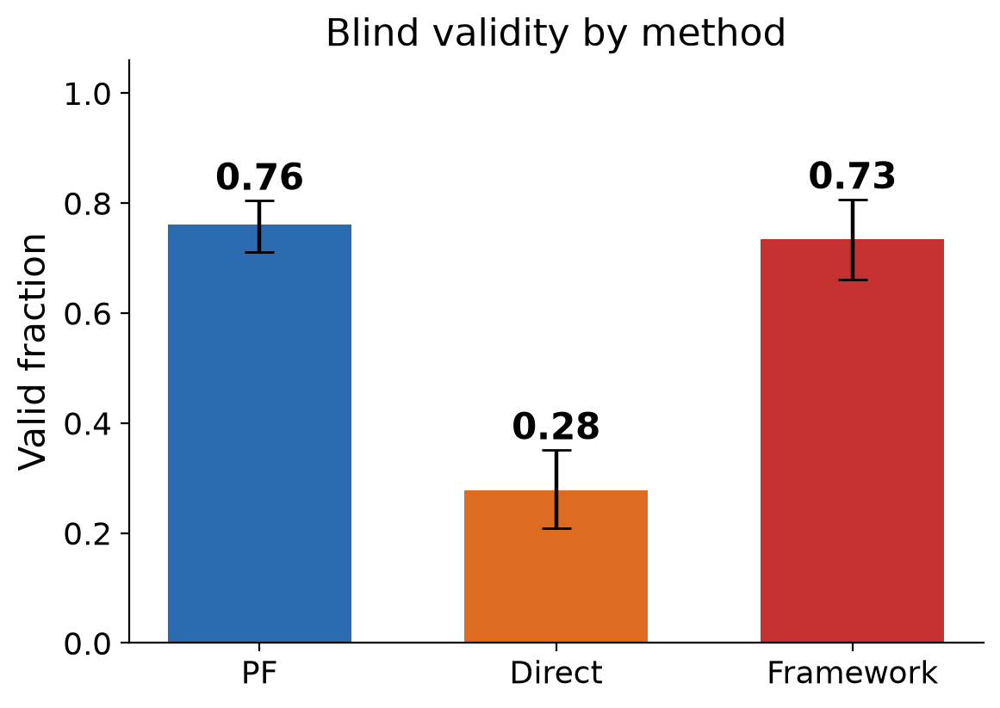
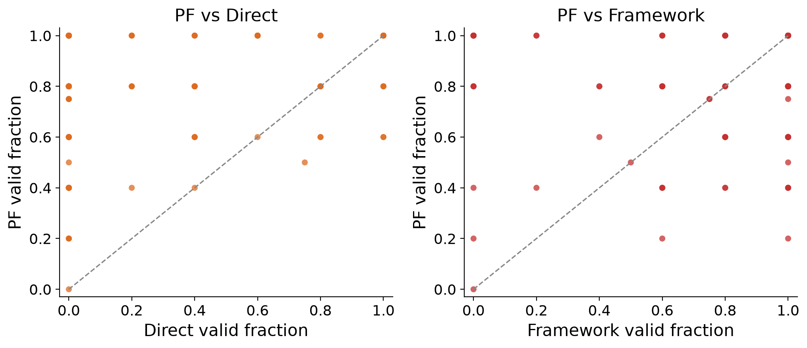
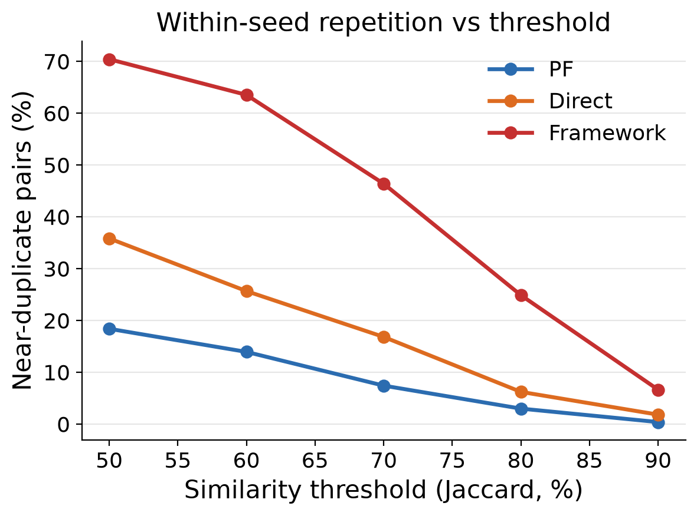
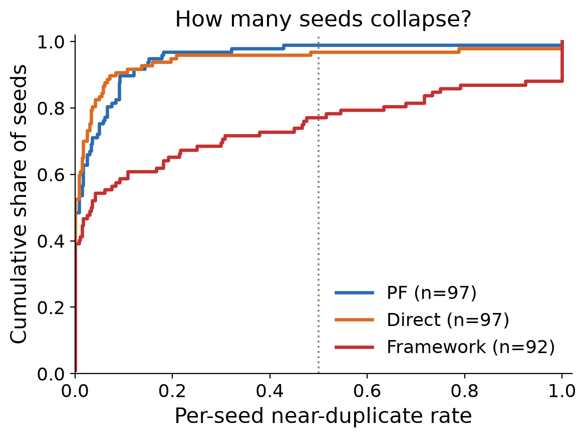
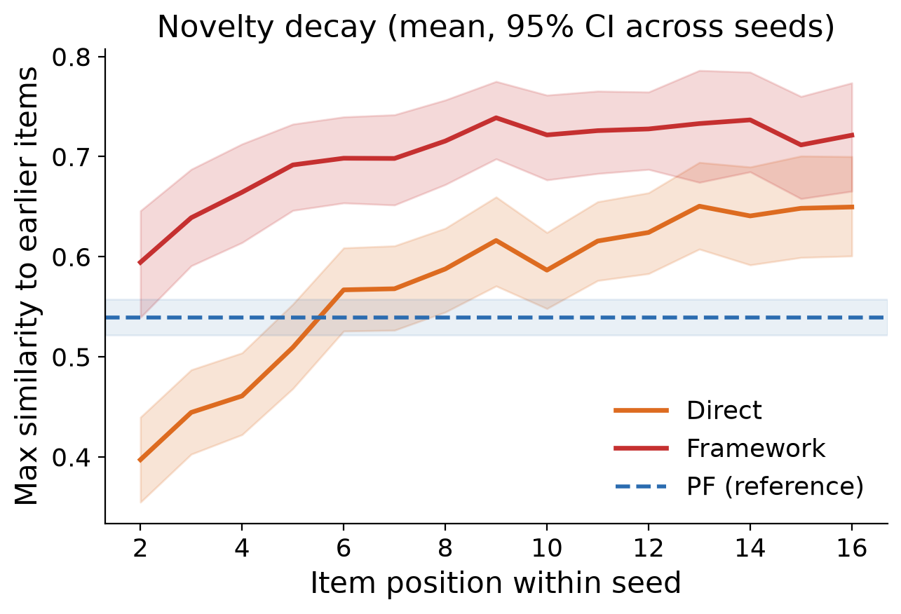
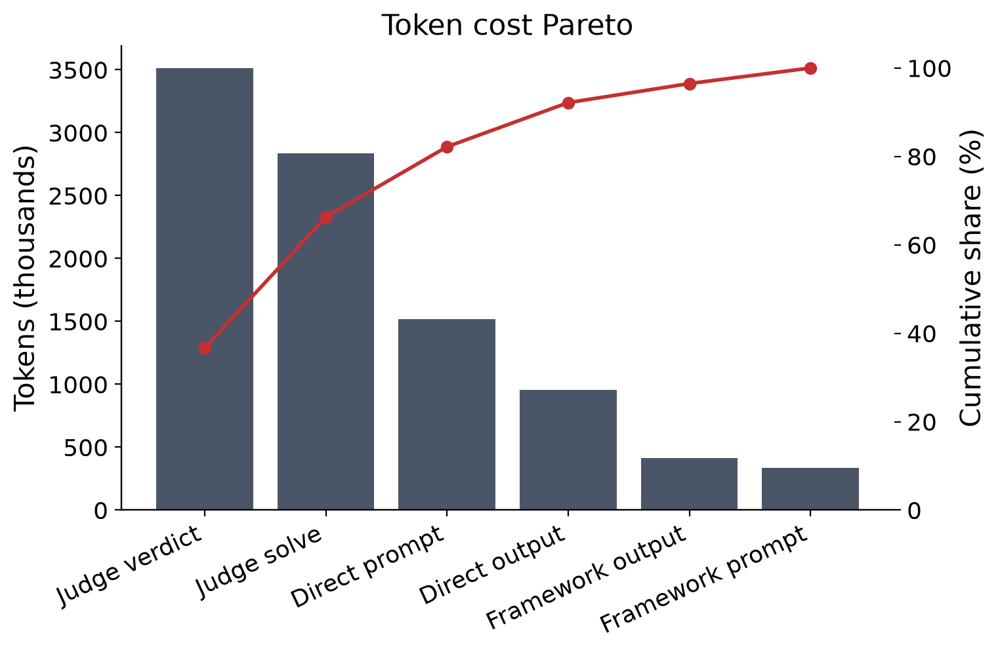
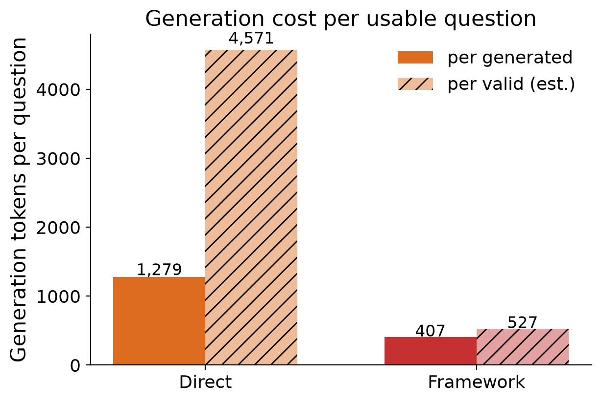
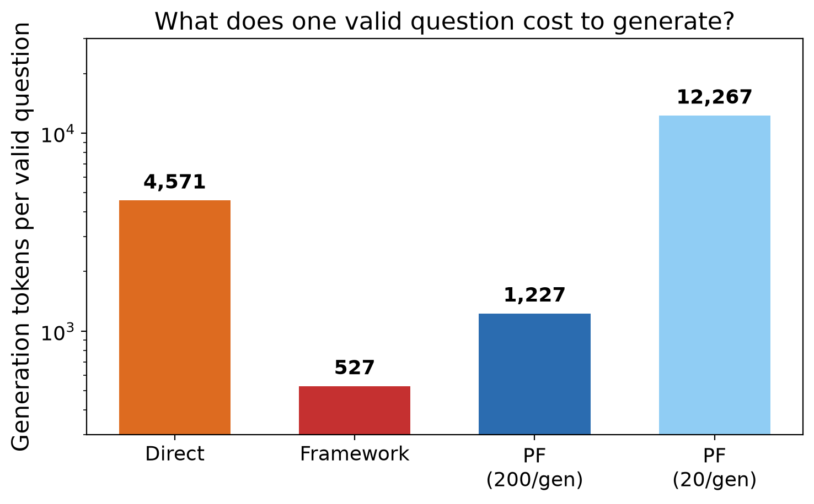
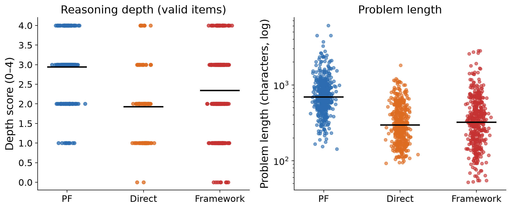

# 图表附录 - 9 张图与说明

图片在 [final_experiment/run/figures/](final_experiment/run/figures/)（PNG + SVG，200 dpi），冻结归档内的副本与 `runs/gpt52_final_20261028/figures/` 逐字节相同，以归档为准（受 `final_experiment/checksums.sha256` 校验）。

重画命令：

```bash
MPLCONFIGDIR=tmp/mplconfig tmp/figvenv/bin/python final_experiment/analysis/analyze.py \
  --run runs/gpt52_final_20261028 --figs runs/gpt52_final_20261028/figures
```

## 总览

```
+-------+------------------------+--------------------------------------------+-------+------+
| id    | file                   | shows                                      | table | use  |
+-------+------------------------+--------------------------------------------+-------+------+
| fig1  | fig1_validity          | valid fraction per condition, 95% CI       |  T1   | main |
| fig2  | fig2_per_seed          | per-seed validity, PF vs baseline scatter  |  T2   | main |
| fig3  | fig3_diversity         | near-dup rate vs threshold 0.3-0.9         |  T4   | main |
| fig3b | fig3b_seed_ecdf        | ECDF of per-seed near-dup rate             |  T4   | main |
| fig4  | fig4_novelty           | novelty decay by item position             |  T4   | supp |
| fig5  | fig5_cost_pareto       | token spend by component, cumulative share |  T7   | supp |
| fig6  | fig6_cost_per_question | per generated vs per valid                 |  T6   | supp |
| fig6b | fig6b_pf_cost          | tokens per valid question, PF@200/@20      |  T6   | main |
| fig7  | fig7_depth_length      | depth and length distributions             |  T1   | main |
+-------+------------------------+--------------------------------------------+-------+------+
```

`use` 列：main = 建议放进正文或 rebuttal；supp = 支撑材料。

## fig1 - 有效性



> **Caption.** Blind validity by condition. Bars give the seed-macro valid fraction over the 97 seeds; whiskers are 95% bootstrap intervals over seeds (2,000 resamples).

对应 T1。PF 0.76 / B2 0.73 / B1 0.28（seed 宏平均；按槽位计为 0.763 / 0.733 / 0.279）。

## fig2 - 按 seed 配对的有效率



> **Caption.** Per-seed validity. Each point is one seed (x: baseline, y: PF); points above the diagonal favour PF. Left: PF vs direct. Right: PF vs single-shot generators.

对应 T2。左图 PF 几乎全在对角线上方；右图互有胜负，差距集中在少数 seed。

## fig3 - 近重复随阈值变化



> **Caption.** Within-seed near-duplication against the similarity threshold. Share of item pairs from the same seed whose 4-gram Jaccard similarity exceeds the threshold.

对应 T4。0.8 阈值：PF 3.0%，B1 6.2%，B2 24.9%。

## fig3b - 有多少 seed 坍缩



> **Caption.** How many seeds collapse. Empirical CDF of the per-seed near-duplicate rate at 0.8; the dashed line marks a 50% collapse rate. B2 has 21/92 seeds above 50% and 11 at 100%.

这是"生成器路线会静默坍缩"最直接的一张图，建议与 T4 一起放进正文。

## fig4 - 新颖度衰减



> **Caption.** Novelty decay. Mean maximum similarity of an item to any earlier item of the same seed, by position within the seed; the reference line marks the PF level (0.55).

对应 T4 的补充视角：B1 的新颖度随题量下降并向 PF 靠拢（0.40 -> 0.65），B2 从一开始就更高（0.59 -> 0.72）。

## fig5 - token 花费的构成



> **Caption.** Token spend by component. Bars: tokens per component; line: cumulative share. Judging (solve + verdict) accounts for 66.3% of all tokens.

对应 T7。说明"造题不是主要成本，筛选才是"。

## fig6 - 每题生成成本



> **Caption.** Generation cost per question: tokens per generated item and per valid item, estimated from the item-level validity of the judged sample.

对应 T6，每有效题 4,571（B1）与 527（B2），与 T6、fig6b 完全一致。

## fig6b - 每道有效题的 token



> **Caption.** Generation tokens per valid question. Direct 4,571, single-shot generators 527, PF 1,227 at 200 instances per generator and 12,267 at 20.

对应 T6，与正文数字一致，优先使用这张。

## fig7 - 深度与题面长度



> **Caption.** Reasoning depth and problem length. Left: depth score of valid items (one dot per item, bars are means). Right: problem length on a log scale (bars are medians).

对应 T1。深度 2.94 / 2.34 / 1.93，题面中位 692 / 321 / 297 字符。

## 使用建议

- 放进 rebuttal 或正文：fig1（有效性）、fig3b（B2 坍缩）、fig7（深度与长度）。
- 支撑材料：fig2、fig3、fig4、fig5、fig6、fig6b。
- [final_experiment/prior/200_item/figures/](final_experiment/prior/200_item/figures/) 属早前 200 题实验，不用于本条回复。
